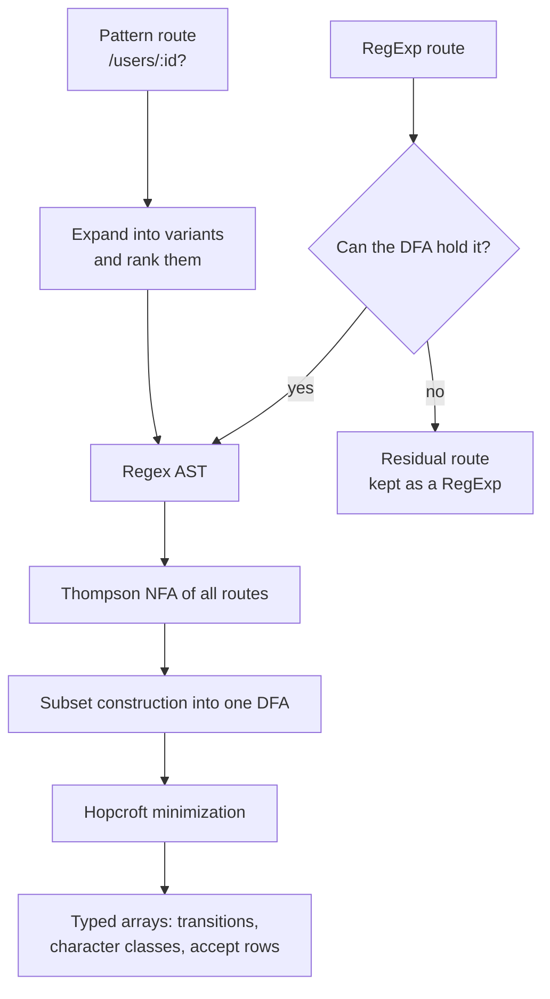
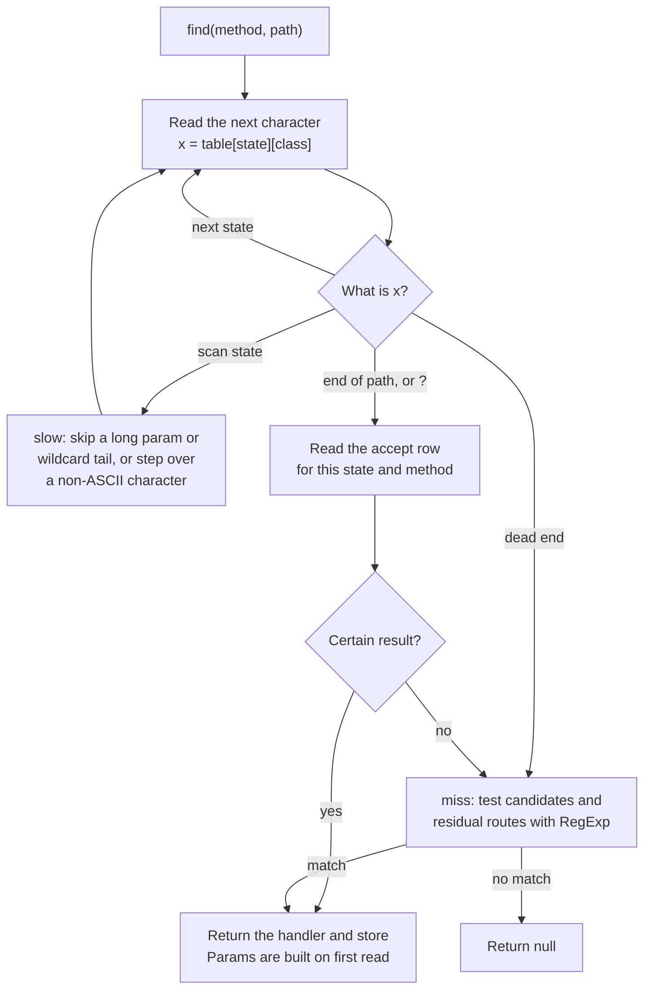

# balancing-router

A fast HTTP router for routes defined as regexes. It compiles the whole route table into one DFA and runs it from a typed-array table, so a lookup reads each character once, and most regex routes can't backtrack.

On the bench traffic it's about 3× faster than a radix-tree router (`@medley/router`) that does less: it validates param regexes, which that router can't. See [Performance](#performance).

## Usage

```js
import { createRouter } from "balancing-router";
import http from "node:http";

const router = createRouter();

router.on("GET", "/users/:id", (req, res, params) => {
  res.writeHead(200, { "content-type": "application/json" });
  res.end(JSON.stringify({ id: params.id }));
});

router.on(["GET", "POST"], /^\/api\/v\d+\/health$/, (req, res) => {
  res.writeHead(204);
  res.end();
});

const server = http.createServer((req, res) => {
  const match = router.find(req.method ?? "GET", req.url ?? "/");
  if (!match) {
    res.writeHead(404);
    res.end("not found");
    return;
  }
  match.handler(req, res, match.params);
});

server.listen(3000);
```

## API

### `createRouter(options?): Router`

`options.maxStates` caps the size of the compiled DFA. The default is 262,144 states. Compiling fails past it, and the error names the route that went over.

### `router.on(method, path, handler, store?)`

Registers a route, and returns the router.

- `method`: a string or an array of strings. `"*"` matches any method. Case and surrounding spaces are ignored.
- `path`: a route pattern or a `RegExp`.
- `handler`: `(req, res, params) => any`.
- `store`: optional data, returned with the match.

Registering a pattern again for the same method replaces it and keeps its original position. That applies per variant: `/a` replaces the shorter form of an earlier `/a/:x?`.

### `router.find(method, path): RouteMatch | null`

Returns `{ handler, params, store }`, or `null`.

- `params` is built on first read. A route with no params returns a shared result with frozen `params`, so don't mutate it.
- All three are getters, so read them by name: `{ ...match }` and `Object.keys(match)` won't include them.
- `path` may include a query string, which is ignored.

### `router.compile()`

Compiles the route table now, instead of on the first `find`. Registering another route undoes this.

### `router.residual(): string[]`

Lists the routes that aren't fully compiled into the DFA. See [Regex routes](#regex-routes).

## Patterns

| Pattern | Matches | `params` |
|---|---|---|
| `/users` | `/users` | |
| `/users/:id` | `/users/42` | `{ id: "42" }` |
| `/items/:id?` | `/items`, `/items/42` | `{}`, `{ id: "42" }` |
| `/orders/:id(\d+)` | `/orders/42`, not `/orders/x` | `{ id: "42" }` |
| `/users/:id#int` | `/users/42`, not `/users/x` | `{ id: "42" }` |
| `/(catalog\|portal)/home` | `/catalog/home`, `/portal/home` | |
| `/files/*` | `/files`, `/files/`, `/files/a/b` | `{ "*": "a/b" }` |
| `/assets/:path*` | `/assets`, `/assets/a/b` | `{ path: "a/b" }` |

The validator aliases are `#int`, `#alpha`, `#slug`, `#locale`, and `#uuid`. An unknown alias throws.

A wildcard ends the pattern, so anything after it is ignored. A param's regex can cross `/`, as in `:rest(.+)`. A route can expand to at most 256 variants, which is 8 optional segments.

### Matching rules

- Trailing and double slashes count: `/items/` doesn't match `/items`.
- `?` ends the path.
- Paths aren't decoded: `%2F` stays as it is.
- A missing leading `/` is added, and an empty path means `/`.

### Priority

For a URL and method, the first of these tiers with a match wins:

1. Pattern routes for the method
2. Pattern routes for `*`
3. Regex routes for the method
4. Regex routes for `*`

Within a pattern tier, routes compare left to right by segment, and the first difference decides. From strongest to weakest, segments are: static, `#int`, `#uuid`, `#locale`, `#alpha`, `#slug`, `:name(regex)`, `:name`, wildcard. Ties go to registration order. Within a regex tier, registration order decides.

## Regex routes

A `RegExp` route is matched against the path, without the query string. Named groups become params:

```js
router.on("GET", /^\/orders\/(?<id>\d+)$/, handler); // params: { id: "42" }
```

Most regexes compile into the DFA, where they run in linear time and can't backtrack. These can't, and stay as **residual** routes, tested with `RegExp` after the DFA finds no pattern route:

- Backreferences, lookaround, `\b`, and `\p{...}`
- The `m`, `u`, and `v` flags
- `^` or `$` anywhere but the ends
- Any route needing more than 4,096 DFA states on its own

Residual routes still work and keep their priority, but they can backtrack, so a bad regex is exposed to ReDoS. A long, crafted path can stall `RegExp` for seconds. Check `router.residual()` to see which routes this applies to.

A param regex that can't compile works the same way: the route still ranks normally, and a match is confirmed with `RegExp`.

## How it works

The route table compiles once, on `compile()` or the first `find`. Every route goes into the same DFA, so routes that share a prefix share states:



A lookup then walks that table one character at a time. The route count doesn't change the number of steps, and the winning route was already decided at compile time, so a normal lookup only reads its result from the accept row:



`how-it-works.md` explains the design.

## Performance

Measured with `bench/bench.mjs` on an Apple M1 Pro with Node 22, best of 3 seeds. The URLs are fresh strings, as a real `req.url` would be, and `@medley/router` is given routes it can match. Lookups slow down as the table grows and stops fitting in cache: 95ns at 100 routes, and 166ns at 3,000.

| Traffic | Params | balancing-router | @medley/router | Ratio |
|---|---|---:|---:|---:|
| 34 routes, shuffled | not read | 20.5M/s (49ns) | 6.9M/s (144ns) | 2.96× |
| 34 routes, shuffled | read | 14.2M/s (71ns) | 6.8M/s (148ns) | 2.10× |
| Near-miss 404s | read | 17.8M/s (56ns) | 7.7M/s (130ns) | 2.32× |
| Query strings | read | 12.2M/s (82ns) | 6.7M/s (150ns) | 1.83× |
| 36-character params | read | 12.0M/s (83ns) | 6.7M/s (149ns) | 1.78× |
| 200-character params | read | 11.4M/s (88ns) | 6.4M/s (156ns) | 1.78× |
| 3,000 REST routes | read | 166ns | 282ns | 1.71× |

Compiling 3,000 REST routes takes about 0.1s. These numbers come from a machine that wasn't fully idle, and from one CPU.

## Development

- Build: `npm run build`
- Tests: `npm test`
- Differential test on the full corpus: `npm run test:consistency`
- Benchmarks: `npm run bench`, or `npm run bench:compare` against the previous commit

`bench.mjs` flags include `--only <router>`, `--read-params`, `--corpus near404|query|uuid36|token200`, `--404-percent <n>`, and `--time <ms>`. `--404-percent` replaces that share of the lookups with near-miss URLs that match no route. The corpus's own misses are extra, about 5% of `clean`.
