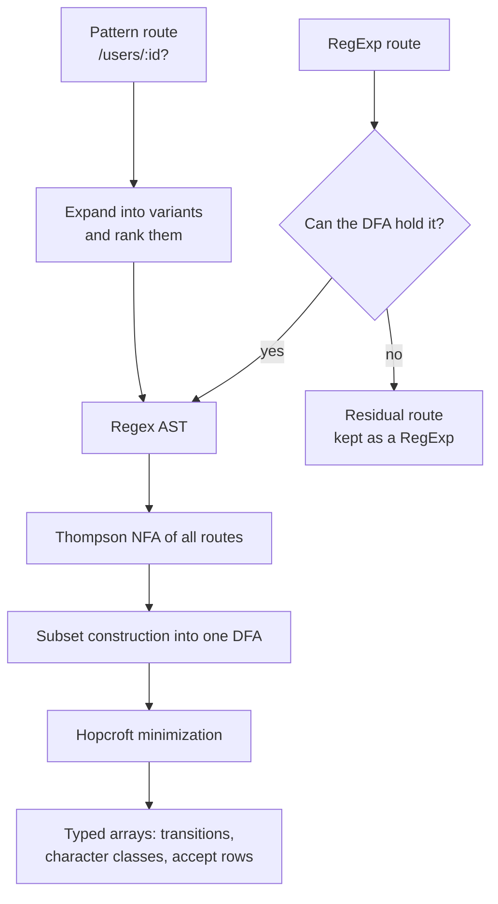
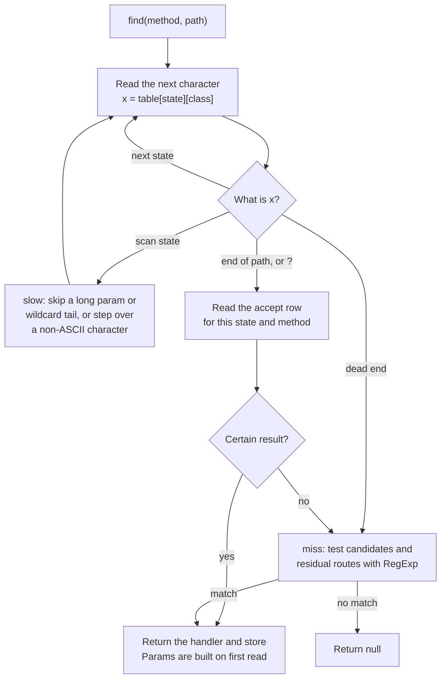

# dfast-router

A fast HTTP router for routes defined as regexes. It compiles the whole route table into one DFA and runs it from a typed-array table, so a lookup reads each character once, and most regex routes can't backtrack.

On the bench traffic it's about 3× faster than a radix-tree router (`@medley/router`) that does less: it validates param regexes, which that router can't. Against Express's router, which enforces the same routes and matches exactly the same URLs, it's at least 13× faster with params read. `find-my-way`, the router inside Fastify, enforces them too: with params read, this is at least 2× faster than the tree walk Fastify runs, and 1.2× to 1.8× faster than `find-my-way`'s opt-in compiled mode. See [Performance](#performance).

## Usage

The router finds a handler and gives it back, and your code calls it. So you choose the handler's type, as long as it takes `params` and `store` first. Anything after those is yours, such as `req` and `res`:

```ts
import { createRouter, type Params } from "dfast-router";
import http, { type IncomingMessage, type ServerResponse } from "node:http";

interface RouteMeta {
  auth: boolean;
}
type Handler = (params: Params, store: RouteMeta, req: IncomingMessage, res: ServerResponse) => void;

const router = createRouter<Handler>();

router.on("GET", "/users/:id", (params, store, req, res) => {
  res.writeHead(200, { "content-type": "application/json" });
  res.end(JSON.stringify({ id: params.id, auth: store.auth }));
}, { auth: true });

router.on(["GET", "POST"], /^\/api\/v\d+\/health$/, (params, store, req, res) => {
  res.writeHead(204);
  res.end();
}, { auth: false });

const server = http.createServer((req, res) => {
  const match = router.find(req.method ?? "GET", req.url ?? "/");
  if (!match) {
    res.writeHead(404);
    res.end("not found");
    return;
  }
  match.handler(match.params, match.store, req, res);
});

server.listen(3000);
```

Without a server there's no `req` or `res`, so the same router works in a browser. Register on `"*"` if methods mean nothing there:

```ts
import { createRouter, type Params } from "dfast-router";

interface PageMeta {
  title: string;
}
type Handler = (params: Params, store: PageMeta) => string;

const router = createRouter<Handler>();

router.on("*", "/docs/:page", (params, store) => `${store.title}: ${params.page}`, { title: "Docs" });

const match = router.find("GET", location.pathname);
document.title = match ? match.handler(match.params, match.store) : "Not found";
```

## API

### `createRouter<THandler>(options?): Router<THandler>`

`THandler` is the type of your handlers, and it must take `(params, store, ...rest)`. The store's type comes from its second param. To type only the store, use `createRouter<RouteHandler<PageMeta>>()`. Without a type argument, handlers and stores are unchecked.

`options.maxStates` caps the size of the compiled DFA. The default is 262,144 states. Compiling fails past it, and the error names the route that went over.

### `router.on(method, path, handler, store?)`

Registers a route, and returns the router.

- `method`: an HTTP method, `"*"` for any method, or an array of those. In TypeScript it must be an uppercase standard method, so a custom one needs `as RouteMethod`. JavaScript callers can pass any string: case and surrounding spaces are ignored.
- `path`: a route pattern or a `RegExp`.
- `handler`: a `THandler`, returned with the match.
- `store`: data of the handler's store type, returned with the match. It's required unless that type allows `undefined`.

Registering a pattern again for the same method replaces it and keeps its original position. That applies per variant: `/a` replaces the shorter form of an earlier `/a/:x?`.

### `router.find(method, path): RouteMatch<THandler> | null`

Returns `{ handler, params, store }`, or `null`.

- `method` is any string, since it usually comes from the request. A method no route names reaches only `"*"` routes.
- `params` is built on first read. A route with no params returns a shared result with frozen `params`, so don't mutate it.
- All three are getters, so read them by name: `{ ...match }` and `Object.keys(match)` won't include them.
- `path` may include a query string, which is ignored.

### `router.compile()`

Compiles the route table now, instead of on the first `find`. Registering another route undoes this.

### `router.residual(): string[]`

Lists the routes that aren't fully compiled into the DFA. See [Regex routes](#regex-routes).

## Patterns

| Pattern | Matches | `params` |
|---|---|---|
| `/users` | `/users` | |
| `/users/:id` | `/users/42` | `{ id: "42" }` |
| `/items/:id?` | `/items`, `/items/42` | `{}`, `{ id: "42" }` |
| `/orders/:id(\d+)` | `/orders/42`, not `/orders/x` | `{ id: "42" }` |
| `/users/:id#int` | `/users/42`, not `/users/x` | `{ id: "42" }` |
| `/(catalog\|portal)/home` | `/catalog/home`, `/portal/home` | |
| `/files/*` | `/files`, `/files/`, `/files/a/b` | `{ "*": "a/b" }` |
| `/assets/:path*` | `/assets`, `/assets/a/b` | `{ path: "a/b" }` |

The validator aliases are `#int`, `#alpha`, `#slug`, `#locale`, and `#uuid`. An unknown alias throws.

A wildcard ends the pattern, so anything after it is ignored. A param's regex can cross `/`, as in `:rest(.+)`. A route can expand to at most 256 variants, which is 8 optional segments.

### Matching rules

- Trailing and double slashes count: `/items/` doesn't match `/items`.
- `?` ends the path.
- Paths aren't decoded: `%2F` stays as it is.
- A missing leading `/` is added, and an empty path means `/`.

### Priority

For a URL and method, the first of these tiers with a match wins:

1. Pattern routes for the method
2. Pattern routes for `*`
3. Regex routes for the method
4. Regex routes for `*`

Within a pattern tier, routes compare left to right by segment, and the first difference decides. From strongest to weakest, segments are: static, `#int`, `#uuid`, `#locale`, `#alpha`, `#slug`, `:name(regex)`, `:name`, wildcard. Ties go to registration order. Within a regex tier, registration order decides.

## Regex routes

A `RegExp` route is matched against the path, without the query string. Named groups become params:

```js
router.on("GET", /^\/orders\/(?<id>\d+)$/, handler); // params: { id: "42" }
```

Most regexes compile into the DFA, where they run in linear time and can't backtrack. These can't, and stay as **residual** routes, tested with `RegExp` after the DFA finds no pattern route:

- Backreferences, lookaround, `\b`, and `\p{...}`
- The `m`, `u`, and `v` flags
- `^` or `$` anywhere but the ends
- Any route needing more than 4,096 DFA states on its own

Residual routes still work and keep their priority, but they can backtrack, so a bad regex is exposed to ReDoS. A long, crafted path can stall `RegExp` for seconds. Check `router.residual()` to see which routes this applies to.

A param regex that can't compile works the same way: the route still ranks normally, and a match is confirmed with `RegExp`.

## How it works

The route table compiles once, on `compile()` or the first `find`. Every route goes into the same DFA, so routes that share a prefix share states:



A lookup then walks that table one character at a time. The route count doesn't change the number of steps, and the winning route was already decided at compile time, so a normal lookup only reads its result from the accept row:



`how-it-works.md` explains the design.

## Performance

Measured with `bench/bench.mjs` on an Apple M1 Pro with Node 22, best of 3 seeds. The URLs are fresh strings, as a real `req.url` would be, and `@medley/router` is given routes it can match. Lookups slow down as the table grows and stops fitting in cache: 95ns at 100 routes, and 166ns at 3,000.

| Traffic | Params | dfast-router | @medley/router | Ratio |
|---|---|---:|---:|---:|
| 34 routes, shuffled | not read | 20.5M/s (49ns) | 6.9M/s (144ns) | 2.96× |
| 34 routes, shuffled | read | 14.2M/s (71ns) | 6.8M/s (148ns) | 2.10× |
| Near-miss 404s | read | 17.8M/s (56ns) | 7.7M/s (130ns) | 2.32× |
| Query strings | read | 12.2M/s (82ns) | 6.7M/s (150ns) | 1.83× |
| 36-character params | read | 12.0M/s (83ns) | 6.7M/s (149ns) | 1.78× |
| 200-character params | read | 11.4M/s (88ns) | 6.4M/s (156ns) | 1.78× |
| 3,000 REST routes | read | 166ns | 282ns | 1.71× |

Compiling 3,000 REST routes takes about 0.1s. These numbers come from a machine that wasn't fully idle, and from one CPU.

### Against Express

Express's router can enforce the same routes, so this is the like-for-like comparison: the same 34 routes, with param regexes enforced by the matcher, and `strict` and `caseSensitive` on to match this router's rules. Measured with `npm run bench:compare -- --read-params`, best of 3, with Express 5.3 and 4.22.

| Traffic | Hit rate | dfast-router | Express 5 | Express 4 | vs Express 5 | vs Express 4 |
|---|---:|---:|---:|---:|---:|---:|
| 34 routes, shuffled | 94.95% | 14.3M/s (70ns) | 1.11M/s (903ns) | 1.01M/s (993ns) | 13× | 14× |
| Near-miss 404s | 16.92% | 18.8M/s (53ns) | 890K/s (1,124ns) | 714K/s (1,401ns) | 21× | 26× |
| Query strings | 94.95% | 12.0M/s (83ns) | 928K/s (1,078ns) | 842K/s (1,188ns) | 13× | 14× |

Both Express versions matched the reference with no over-matching or under-matching on all five corpora. On near-miss 404s, `@medley/router` reports 27.0% and `path-to-regexp-linear` 46.0%, because neither can enforce param regexes. `npm run test:consistency` also compares route and params URL by URL: 0 mismatches on 1.3M lookups of these routes for each Express version. It leaves out URLs containing `%`, because Express decodes params and this router doesn't.

What differs between the numbers:

- Express runs its real `Router` dispatch through to the route's handler, because it has no separate lookup. `find()` returns the match without calling the handler.
- Neither number includes HTTP parsing or a response. An `express()` app also adds its own middleware, which these leave out.
- Express tests routes one at a time, so its cost grows with the table and depends on route order. The routes are registered in file order. On a URL matching two routes, Express takes the first registered, and this router takes the highest ranked. No URL in the test did.
- Express 4 takes the route strings as they are. Express 5 dropped that syntax, so each route is registered as one `RegExp`, which is how it validates.

Express's code didn't change between comparison runs, and its numbers still moved by up to 4%, so treat these as approximate.

### Against find-my-way

`find-my-way` is the router inside Fastify. It enforces param regexes, and its `find` returns a match without calling the handler, so it does the same job as `find()` here, and needs no dispatch around it. These are the same 34 routes, measured with `npm run bench:compare -- --read-params`, best of 3, with find-my-way 9.10.

| Traffic | Hit rate | dfast-router | find-my-way compiled | find-my-way tree | vs compiled | vs tree |
|---|---:|---:|---:|---:|---:|---:|
| 34 routes, shuffled | 94.95% | 14.1M/s (71ns) | 10.8M/s (92ns) | 6.52M/s (153ns) | 1.3× | 2.2× |
| Near-miss 404s | 16.92%, find-my-way 20.68% | 18.2M/s (55ns) | 10.2M/s (98ns) | 5.85M/s (171ns) | 1.8× | 3.1× |
| Query strings | 94.95% | 11.6M/s (86ns) | 10.0M/s (100ns) | 5.38M/s (186ns) | 1.2× | 2.2× |

Both modes matched the reference exactly on the other four corpora. The near-miss row isn't quite like for like: `find-my-way` lets a plain param be empty, so `/items/` matches `/items/:id`, and that accounts for every over-match in the 1M URLs. It under-matched nothing. `npm run test:consistency` compares route and params URL by URL: 0 mismatches on 1.3M lookups of these routes in each mode. It counts an empty param as a miss, and leaves out URLs containing `%`, because `find-my-way` decodes params and this router doesn't.

What differs between the numbers:

- The tree walk is what Fastify runs. `compile()` generates JavaScript from the tree, and Fastify doesn't call it, so the compiled column is the fastest this library gets, not what a Fastify app gets.
- Neither number includes HTTP parsing, a response, or Fastify's own request handling.
- `find-my-way` is configured to do this router's job. `maxParamLength` is raised, because the default of 100 turns a longer param into a miss. Its query string parser is replaced with a stub, because `find` parses the query string by default and `find()` here leaves that to the caller.
- `find-my-way` builds params on every lookup, and this router builds them on first read. That's why these numbers read params, and why this table has no row without them.

`find-my-way`'s code didn't change between comparison runs, and its numbers still moved by up to 5%, so treat these as approximate.

## Development

- Build: `npm run build`
- Tests: `npm test`
- Differential test on the full corpus: `npm run test:consistency`
- Benchmarks: `npm run bench`, or `npm run bench:compare` against the previous commit

`bench.mjs` flags include `--only <router>`, `--routes <set>`, `--read-params`, `--corpus near404|query|uuid36|token200`, `--404-percent <n>`, and `--time <ms>`. `--404-percent` replaces that share of the lookups with near-miss URLs that match no route. The corpus's own misses are extra, about 5% of `clean`.

`--routes` takes a name, so `--routes generic` (the default) loads `bench/routes-generic.mjs`, or a path to a routes module. The URLs come from the `.urls.mjs` file next to that module, or are generated from its routes if there isn't one. `--urls <path>` overrides them.

`npm run bench:compare` takes `--time <ms>`, `--runs <n>`, and `--seed <n>`, and passes everything else to `bench.mjs`: `npm run bench:compare -- --routes generic --corpus near404`.
