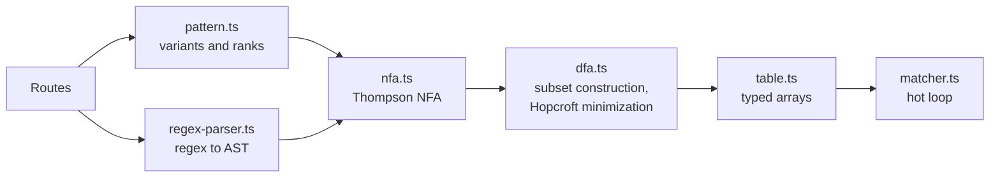

# How it works

The router treats the whole route table as one regular language. It compiles that language into a DFA ahead of time, then runs the DFA from a typed-array table. A lookup reads each character once, with no backtracking.



## Why a table

This design comes from measuring what a lookup actually spends its time on, on shuffled traffic.

- **Reading characters is cheap.** One more `charCodeAt` costs about 0.6ns. A radix tree's `Map.get` per branch costs about 8ns.
- **Mispredicted branches are expensive.** Each URL takes several unpredictable decisions, such as which route, and whether there's a locale. Generated JavaScript lost 28ns of its 59ns to mispredicts: it ran in 32ns on the same URLs sorted.
- **A table turns those decisions into data.** A lookup in a table doesn't branch on the data it reads, so the only unpredictable branch left is the loop's exit.

So routing branches aren't generated. That also avoids V8's 61,440-byte limit on optimizing a function: a code generator that unfolded the DFA produced 6.5MB of source, and ran at 6µs a lookup in the interpreter.

## The hot loop

```ts
for (; i < n; i++) {
  const c = s.charCodeAt(i);
  x = TT[(st << K) + CLS[c]];
  if (x >= STOP) break;
  st = x;
}
```

`CLS` compresses the alphabet into classes of symbols no route tells apart, which keeps rows short. It has an entry for every char code, so V8 drops its bounds check, and a non-ASCII character takes no branch. `x >= STOP` is the only check per character. Everything rare leaves through it, by the value in the table:

| Value of `x` | Meaning |
|---|---|
| Below `STOP` | The next state |
| `STOP` | Dead: no route continues |
| `SCAN` and up | Continue in `slow`, from state `x - SCAN` |

Rules for changing this loop, each from a measurement:

1. **Keep one flat loop.** Nesting it cost 5.5ns even when the outer loop never ran.
2. **Allow one exit check per character.**
3. **Don't track slashes while scanning.** Recover positions after the match.
4. **Put rare work in `slow`,** never in `find`.
5. **Don't generate routing branches.**

## Leaving the hot loop

`slow` owns everything else, and keeps its own loop so that `find` can stay flat.

- **Long params.** Stepping through a long param costs more than `indexOf`. A short param stays in the table through a chain of copies of its scan state, and a long one leaves for `slow`, which searches for the next `/`. Tables past 1,500 states drop the chains, which are 15% faster at 34 routes but 12% slower at 300.
- **Tails.** A state that loops on everything but `?`, like a wildcard's, can't be left, so `slow` jumps to the end of the path.
- **Non-ASCII characters.** See below.

## Non-ASCII paths

The alphabet has 129 symbols: ASCII, plus one for every code unit above it. That can't separate `/café` from `/cafü`, or express that `.` excludes U+2028. So sets may over-accept above ASCII, but never under-accept.

- The parser marks a route **inexact** if any of its sets holds only part of the range above ASCII.
- A transition on a non-ASCII character always leaves the hot loop, so it pays nothing for this.
- `slow` carries on with the DFA. If the result is inexact, `miss` confirms candidates in priority order with `RegExp`. Exact results skip this, and most routes are exact.

A missing transition on a non-ASCII character is still an exact rejection, because sets never under-accept.

## Methods

One DFA serves every method. Each state keeps every route that accepts there, and a row per distinct accept set holds one result per method. Ties follow each method's own registration order, so each method ranks routes separately.

## Params

Every hit returns the same class, `Match`, so a caller's reads stay monomorphic. A match holds only a pointer to its route's shared data, the path, and where the path ends, and a route with no params reuses a single match.

`find` does no work for params. On first read, `Match.params` runs the variant's extractor, which uses the cheapest method that is correct:

1. Fixed offsets, when everything before the param has a known width
2. Anchoring from the end, when everything after it has a known width
3. `indexOf('/')`, when the param can't contain `/`
4. `RegExp.exec`, for anything else

Extractors are generated with `new Function`, so that each params object has a fixed shape. Routes of one shape share a function, with their offsets in a closure: 3,000 routes would otherwise be 3,000 functions, each called too rarely for V8 to optimize. Where code generation is blocked, as under a strict CSP, extractors use `RegExp`.

## Budgets

A DFA can be exponentially larger than its routes, so nothing about its size is assumed.

- **Per route.** A route needing more than 4,096 states alone is left out of the DFA, and runs as a residual route.
- **Per table.** Past `maxStates`, compiling fails, and the error names the route that went over.

Route tables with heavy overlap between params and literals are the worst realistic case: 300 such routes need about 80,000 states and compile in 0.7s. A REST API of 3,000 routes needs about 14,000.

## Testing

`bench/reference.mjs` is a slow, independent model of the router: one `RegExp` per variant, scanned in priority order. It imports nothing from `src/`.

- `test/router-consistency.test.mjs` compares the router with it, on route and params, across the bench corpora and their mutations. A self-test proves that the comparison can fail.
- `test/fixtures/routes-overlap.mjs` exists because no URL in the bench route sets matches more than one route, so they can't detect a ranking bug.
- `test/compiler/regex-fuzz.test.ts` compares the parser with `RegExp`.

## Measuring

- **Run one router per process.** Otherwise one router's type feedback slows down the next.
- **Replay fresh strings.** Literals are internalized with cached hashes, which flatters URL caches.
- **Check the hit rate.** `bench.mjs` fails a run that under-matches the reference. A router that returns `null` for most URLs looks fast.
- **Keep the machine quiet.** The same code ran 12% slower with 6 busy processes, and 41% slower with 8.
